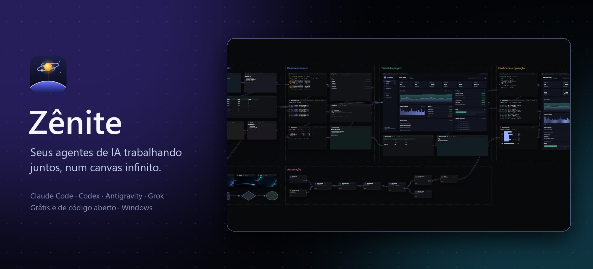
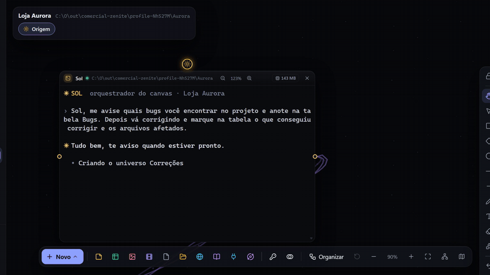
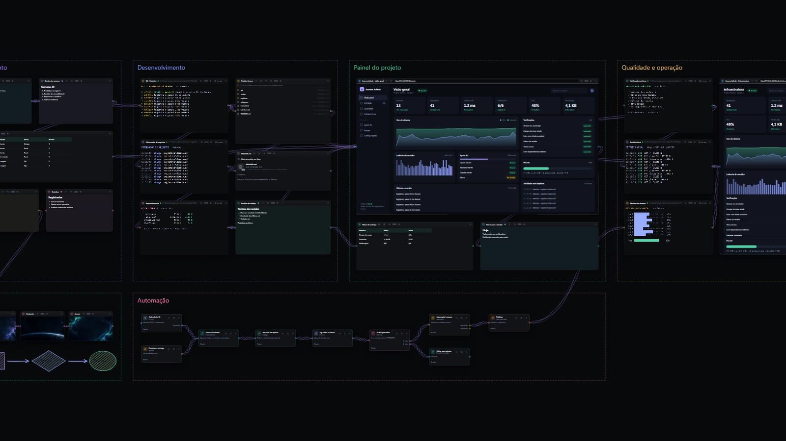
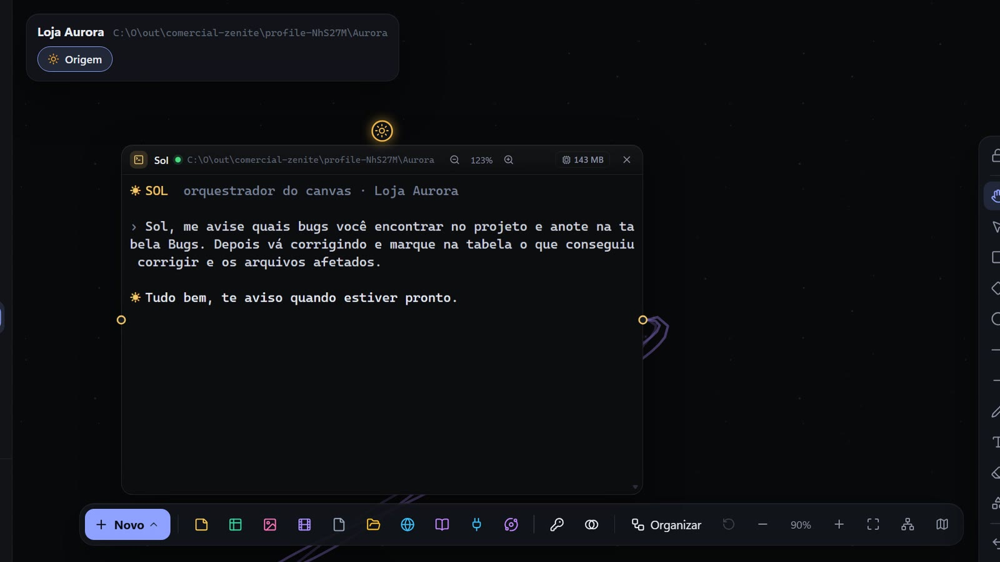
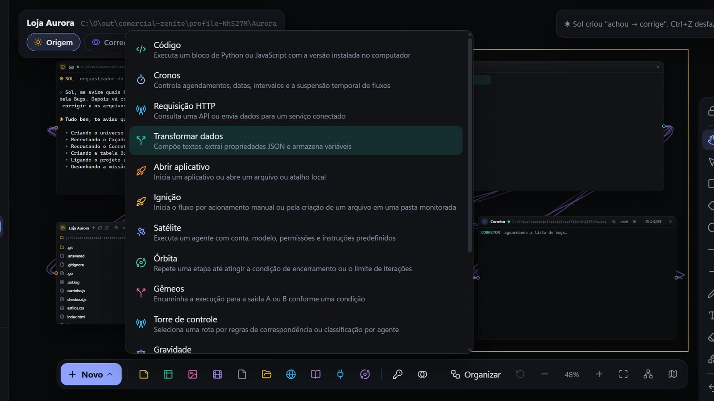
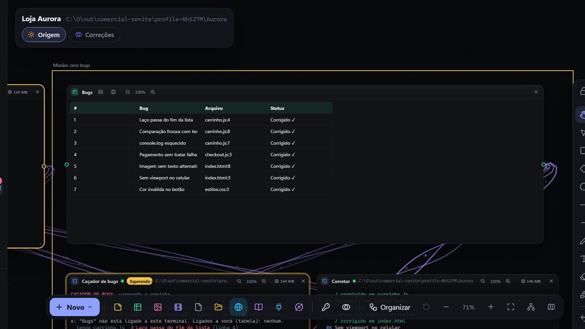
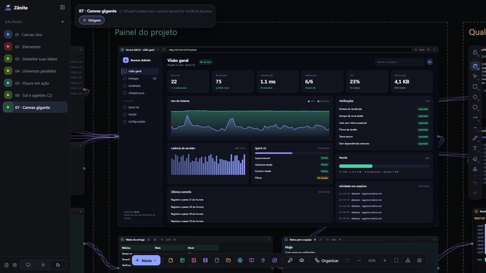
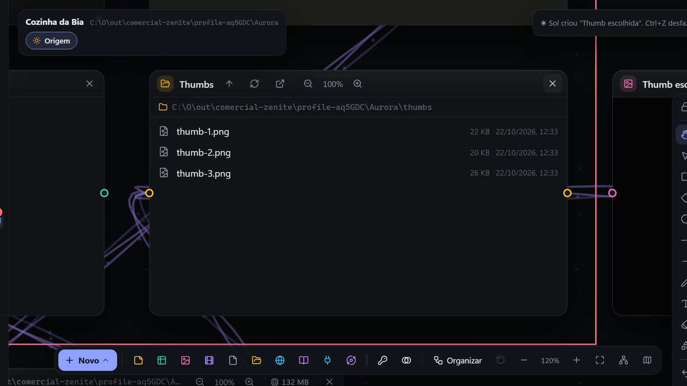
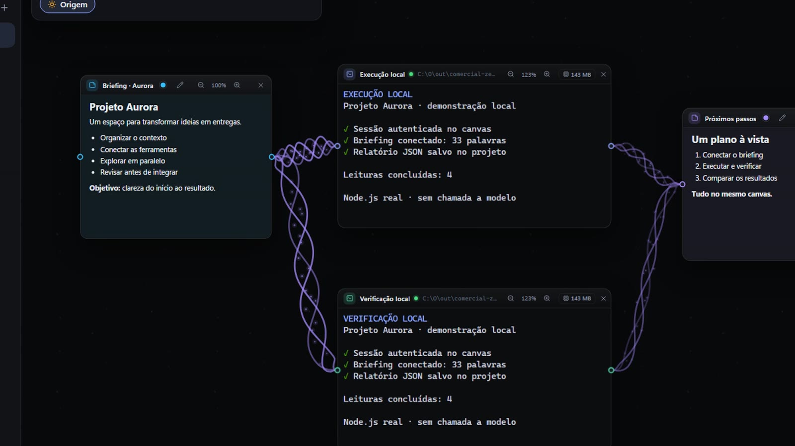
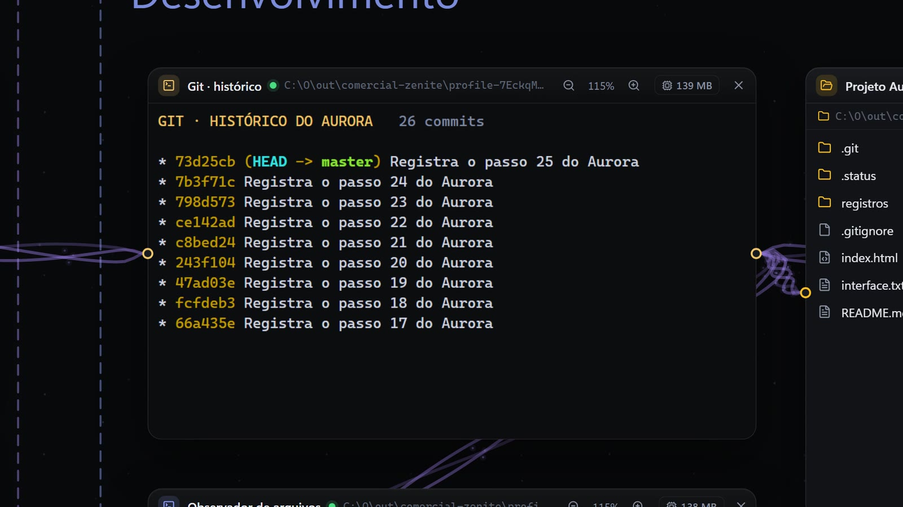

<p align="center">
  
</p>

<p align="center">
  <a href="https://github.com/Nata-Felix/Zenite/releases/latest"></a>
  <a href="https://github.com/Nata-Felix/Zenite/releases"></a>
  
  <a href="LICENSE"></a>
</p>

<p align="center">
  <a href="https://github.com/Nata-Felix/Zenite/releases/latest"><b>⬇ Baixar para Windows</b></a>
  &nbsp;·&nbsp; <a href="#primeiros-passos">Primeiros passos</a>
  &nbsp;·&nbsp; <a href="docs/guia.md">Guia completo</a>
</p>

---

**Zênite** é um canvas infinito para trabalhar com agentes de IA no terminal (Claude Code, Codex,
Antigravity, Grok e outros). Cada agente vira uma janela no canvas, ao lado das notas, tabelas,
sites, arquivos e fluxos do projeto. Você liga o que cada um pode usar, e um agente
coordenador, o **Sol**, distribui o trabalho e monta o resto.

<p align="center">
  
  <br><sub>Um pedido ao Sol: ele recruta a equipe, cria a tabela e os terminais acham e corrigem os bugs ao vivo.</sub>
</p>

## O problema

Quem usa mais de um agente de IA vive alternando janelas: um terminal com o Claude Code, outro
com o Codex, o navegador, o editor, uma planilha e um bloco de notas. Cada agente enxerga só o
que você cola na conversa, ninguém sabe o que o outro está fazendo, e o contexto do projeto
fica espalhado pela área de trabalho.

## Como o Zênite resolve

| Sem o Zênite | Com o Zênite |
|---|---|
| Dez janelas e abas soltas | Um canvas por projeto, com tudo à vista |
| Copiar e colar contexto em cada agente | Ligue a nota ou a tabela ao agente e ele lê direto |
| Agentes isolados, sem saber uns dos outros | Agentes conversam e pedem ajuda pelo canvas (`zn ask`) |
| Você coordena cada passo | O **Sol** recebe o pedido, monta a equipe e acompanha |
| Experimentos que bagunçam o projeto | **Universos**: cópias isoladas no Git, com merge quando der certo |
| Rotinas repetidas à mão | **Astros**: fluxos visuais com horários, condições, aprovações e webhooks |

## Recursos

<table>
  <tr>
    <td width="50%" valign="top">
      
      <h3>Canvas infinito</h3>
      Terminais, notas em Markdown, tabelas, sites, imagens, vídeos, arquivos e pastas no
      mesmo espaço. Organize em áreas, desenhe por cima, agrupe em buracos negros e reorganize
      tudo com um clique.
    </td>
    <td width="50%" valign="top">
      
      <h3>Sol, o orquestrador</h3>
      Promova um terminal a Sol e ele cuida do macro: divide o pedido em tarefas, delega,
      acompanha e valida no fim. Ele reaproveita quem já está no canvas antes de recrutar e
      pergunta a você quando nenhum agente serve. Tudo que ele muda no canvas entra no seu Ctrl+Z.
    </td>
  </tr>
  <tr>
    <td valign="top">
      
      <h3>Astros: fluxos visuais</h3>
      Ignição, Cronos, Satélite, Gêmeos, Torre de controle, Convergência, Espera, Aprovação,
      requisições HTTP, código em Python ou JavaScript e mais. Monte automações ligando blocos,
      sem sair do canvas.
    </td>
    <td valign="top">
      
      <h3>Trabalho que você vê acontecer</h3>
      Os agentes escrevem nas notas e tabelas ligadas a eles enquanto trabalham. Uma tabela de
      bugs se preenche e é marcada como corrigida em tempo real, sem copiar nada.
    </td>
  </tr>
  <tr>
    <td valign="top">
      
      <h3>Sites e painéis dentro do projeto</h3>
      Abra qualquer site ou o seu app em desenvolvimento como um elemento. Os agentes navegam,
      clicam, leem o console e as requisições (o F12 da página) pelo comando <code>zn web</code>.
    </td>
    <td valign="top">
      
      <h3>Não é só para código</h3>
      Roteiro de vídeo, títulos e hashtags numa tabela, thumbs salvas numa pasta ligada: o mesmo
      canvas organiza conteúdo, pesquisa e rotinas de criação.
    </td>
  </tr>
  <tr>
    <td valign="top">
      
      <h3>Ligações que mostram o caminho</h3>
      Cada ligação define o que um agente pode usar e anima quando os dados passam por ela.
      São 13 efeitos de ligação, como Aurora, Microcometas e Hélice galáctica.
    </td>
    <td valign="top">
      
      <h3>Git como memória</h3>
      O histórico do Git vira a memória compartilhada entre agentes e sessões. Commits pequenos
      com o porquê, universos em branches próprias e merge na Origem quando o resultado estiver bom.
    </td>
  </tr>
</table>

### E também

- **Torre de controle com roteiro fixo**: você define em cada rota quando ela vale e quem
  executa (agente, conta, modelo e esforço, com outro agente se faltar limite). Ligada ao Sol,
  ela vira o caminho por onde ele delega, em vez de ele decidir a cada vez.
- **Universos paralelos**: experimente numa cópia do projeto em outra branch, sem tocar a Origem.
- **Contas separadas por terminal**: vários logins do mesmo agente, cada um no seu perfil.
- **Skills e serviços**: ligue instruções (`SKILL.md`), APIs HTTP e servidores MCP aos agentes.
- **Ambiente isolado (opcional)**: rode os agentes em contêiner Docker, sem acesso direto ao disco.
- **Exportar e importar galáxias**, backups automáticos e atualização automática do app.
- **Busca rápida**, atalhos configuráveis, temas e personalização completa.

## Agentes compatíveis

Claude Code · Codex · Antigravity · Grok CLI · OpenRouter · qualquer shell (PowerShell, cmd, Git Bash).
O Zênite não substitui o seu agente: ele roda o CLI que você já usa, com a sua conta.

## Privacidade e segurança

- **Tudo roda no seu computador.** Projetos, canvas, notas e tabelas ficam na sua pasta de dados.
- **Cada agente só vê e usa o que está ligado a ele.** O resto do canvas, e as outras galáxias, nem aparecem.
- **Cada galáxia fica no seu projeto.** Se o Sol tentar ligar uma pasta de fora, o Zênite pergunta
  antes; a liberação lembrada aparece em **Editar galáxia**, onde dá para revogar.
- **Você escolhe as permissões dos agentes**: sempre perguntar, sandbox ou controle total.
- **Chaves e tokens** ficam criptografados pelo Windows, fora do canvas e do Git.
- **Isolamento opcional** em Docker para agentes que você não quer soltos no disco.

Detalhes na [política de segurança](SECURITY.md).

## Primeiros passos

**Antes de começar:** Windows 10 ou 11 e o CLI de pelo menos um agente instalado e com login
feito (por exemplo, `claude` ou `codex` funcionando num terminal). O Git é recomendado, e o Zênite
oferece instalá-lo se faltar. O Docker só é necessário para o ambiente isolado, que é opcional;
o app também o instala pelas Configurações.

1. **Baixe e instale** o `Zenite-Instalador-<versão>.exe` em [Releases](https://github.com/Nata-Felix/Zenite/releases/latest).
2. **Crie uma galáxia** apontando para a pasta do seu projeto.
3. **Clique em + Novo** e abra um terminal com o seu agente (Claude Code, Codex…).
4. **Promova um terminal a Sol** e peça o que precisa. Ou monte você mesmo: crie notas e
   tabelas e ligue-as aos agentes.

Dentro de cada terminal do canvas, o comando `zn` conecta o agente ao Zênite:

```bash
zn list                                  # quem sou eu e o que está ligado a mim
zn note read "Briefing"                  # ler uma nota ligada
zn table set "Bugs" 3 4 "Corrigido ✓"    # escrever numa tabela
zn ask "Revisor" "Pode revisar o PR?"    # conversar com outro agente
zn recruit "Testes" --agent codex        # (Sol) criar um novo agente ligado
```

A lista completa está no [guia](docs/guia.md#como-os-agentes-conversam-comando-zn).

## Perguntas frequentes

**Custa alguma coisa?** O Zênite é gratuito e de código aberto. Os agentes usam as suas próprias
assinaturas ou chaves (Claude, ChatGPT, Gemini, OpenRouter…); o Zênite não cobra nada por cima.

**Funciona no Mac ou no Linux?** Hoje só no Windows 10 e 11.

**Meus dados saem do computador?** O Zênite não tem servidor próprio; ele só consulta o GitHub
para procurar atualizações. O que sai é o que os agentes mandam para os provedores deles, como já
acontece quando você os usa no terminal.

**E se um agente estourar o limite de uso?** Cada terminal mostra o uso da conta dele, o `zn ask`
avisa quem ainda tem folga, e a Torre e a Gravidade podem passar o trabalho para outra conta.

**Preciso saber programar?** Não para usar: canvas, notas, tabelas e o Sol funcionam com pedidos
em português. Os astros de código e o comando `zn` ficam disponíveis para quem quiser ir além.

## Para desenvolvedores

Pré-requisito: [Node.js](https://nodejs.org) 22 ou mais novo.

```bash
npm install
npm start
```

| Comando | O que faz |
|---|---|
| `npm run typecheck` | Verifica os tipos |
| `npm test` | Testes unitários |
| `npm run build` | Gera o app em `out/` |
| `npm run dist:win` | Gera o instalador em `dist/` (o instalador visual exige o [SDK do .NET](https://aka.ms/dotnet/download)) |
| `npm run security:check` | Confere se nada privado vai para o repositório |

### Publicar uma versão

1. Suba a versão: `npm version X.Y.Z --no-git-tag-version` (atualiza `package.json` e `package-lock.json`).
2. Escreva as novidades em [`build/release-notes.md`](build/release-notes.md); elas viram o texto do release.
3. Rode `npm run security:check`, `npm run typecheck` e `npm test`, e commite como `Versão X.Y.Z`.
4. Crie e envie a tag: `git tag vX.Y.Z` e `git push origin main vX.Y.Z`.

O workflow [`release-win.yml`](.github/workflows/release-win.yml) repete as checagens, compila o
instalador e publica o release com os arquivos que o app instalado usa para se atualizar. Confira
no release se o instalador, o `latest.yml` e o `app-update.json` estão lá.

Organização do código, dados, atalhos e publicação de versões estão no
[guia completo](docs/guia.md); os testes, no [catálogo de testes](tests/README.md); a
documentação técnica, em [`docs/`](docs/README.md).

## Licença

[Apache-2.0](LICENSE).
